
<a href="README.md">English</a> | <b>العربية</b>

  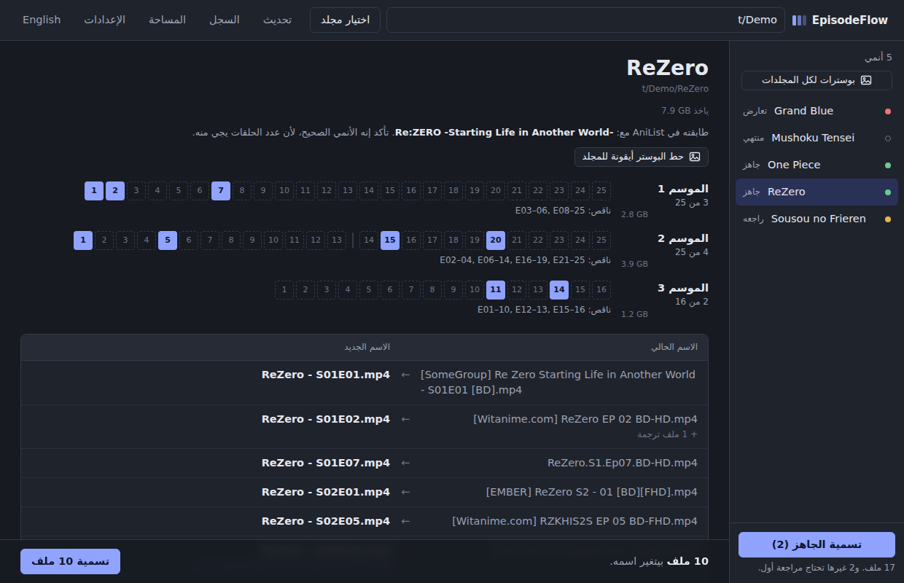

<h1 align="center">EpisodeFlow</h1>

  يرتّب أسماء حلقات الأنمي اللي تحمّلها من أي مكان، بحيث المشغّل يعرف دايماً وش الحلقة الجاية. 
  <code dir="ltr">[SubsPlease] Sousou no Frieren - 05 (1080p) [A1B2C3D4].mkv</code> ← <code dir="ltr">Sousou no Frieren - S02E05.mkv</code>

  
  
  
  
  

  <a href="../../releases/latest"><b>تحميل</b></a> ·
  <a href="#المزايا">المزايا</a> ·
  <a href="#التحميل-والاستخدام">التحميل والاستخدام</a> ·
  <a href="#أسئلة">أسئلة</a> ·
  <a href="#الحذف">الحذف</a>

---

## الجديد في 1.2.0

- **الحلقات الجديدة بنظرة وحدة:** للأنميات اللي لسا تنعرض، يوريك الحلقات اللي نزلت وما عندك، ومتى تنزل الحلقة الجاية.
- **مجلدات المواسم:** لو تبي، ينقل الحلقات لـ `Season 01` و `Season 02` و `Specials`، بالترتيب اللي يبيه Plex و Jellyfin. والتراجع يرجّعها مكانها.
- **مثبّت:** اختر `EpisodeFlow-Setup.exe` (قائمة ابدأ، والإزالة من إعدادات الويندوز) أو `EpisodeFlow.exe` البورتبل مثل قبل.
- وإصلاحات لمجلدات المواسم، والحلقات المزدوجة (`S01E05-E06`)، وملفات `v2`، وغيرها. شوف [سجل التغييرات](CHANGELOG.md).

## المزايا

### يقرأ الأسماء اللي ما يقرأها غيره
حلقات من جروبات مختلفة في نفس المجلد؟ اختصارات مثل `RZKHIS2SP2` و `Season 3 - 10` و `4x22` و `Ep.08` و `S01E05v2` و `第05話`، أو أكواد غريبة، أو نسخ مكررة مثل `(1)`، أو `[4K]` و `FLAC`؟ البرنامج يعرف الموسم والحلقة الصحيحة لكل ملف، و**يحافظ على أرقام الحلقات الحقيقية**، يعني الحلقات من 3 إلى 12 تبقى من 3 إلى 12. وأي ملف مو متأكد منه يحط عليه علامة **«راجعه»** عشان تشيك عليه قبل التسمية. وما يتغير أي اسم إلا لما تضغط **«تسمية»**.

### يعرف كل المواسم والأجزاء من AniList
جزء ثاني (Part 2 أو Cour 2) أرقامه تبدأ من 1؟ البرنامج يسأل [AniList](https://anilist.co) كم حلقة قبله ويكمل العد. مثلاً الحلقة 2 من الجزء الثاني من الموسم الثاني في Re:Zero تصير `S02E15`. ويضبط حتى لو ما عندك ولا حلقة من الجزء الأول.

### تشوف الناقص والجديد بنظرة وحدة
كل موسم له شريط حلقات: المربع المعبّى حلقة عندك، والمنقّط حلقة ناقصة، وفيه خط يوضح وين يبدأ الجزء الثاني. ولو الأنمي لسا ينعرض، الحلقات اللي نزلت وما هي في مجلدك عليها علامة **«جديد»**، واللي ما نزلت للحين باهتة، وتشوف متى تنزل الحلقة الجاية. والقائمة اللي على الجنب توريك كم حلقة جديدة لكل أنمي.

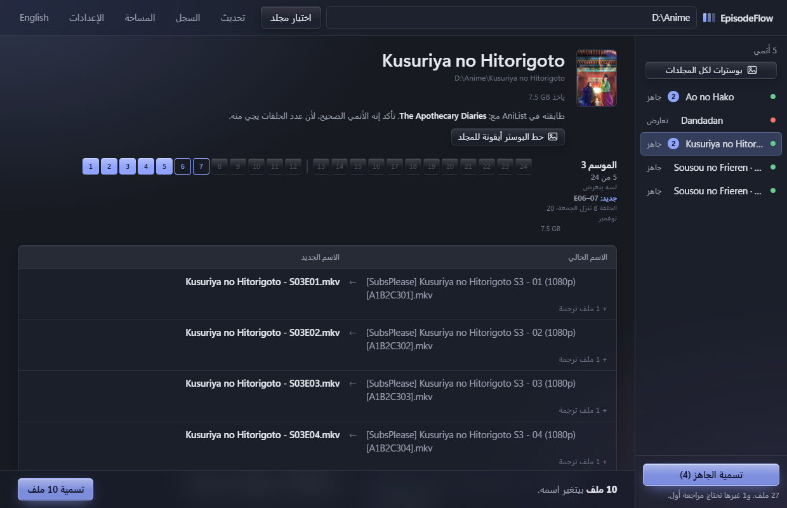

والأنميات الطويلة مثل ون بيس والمحقق كونان، يوريك فيها الحلقات اللي عندك بس، مقسّمة لمجموعات، مع عدد الحلقات اللي بينها:

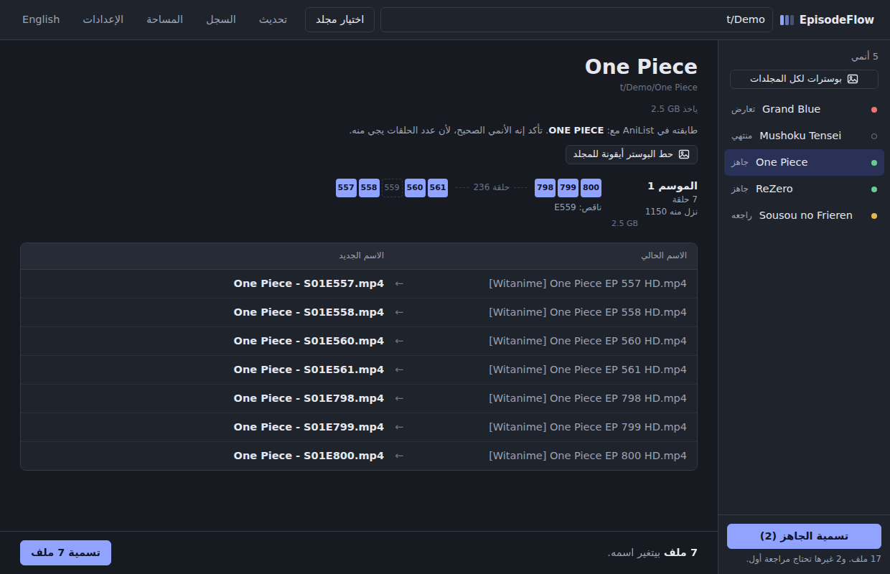

### مجلدات المواسم لـ Plex و Jellyfin
شغّل **الإعدادات** ثم **«شكل اسم الملف»** ثم **«وانقل الحلقات لمجلدات المواسم بعد»**، والحلقات اللي تتسمى تروح لـ `Season 01` و `Season 02` و `Specials` داخل مجلد الأنمي. والتراجع يرجّعها ويشيل المجلدات اللي سواها. والمجلدات اللي مرتبة كذا من قبل (`Frieren/Season 1` و `Frieren/Specials`) يقرأها كأنمي واحد، وكل مجلد بموسمه الصح.

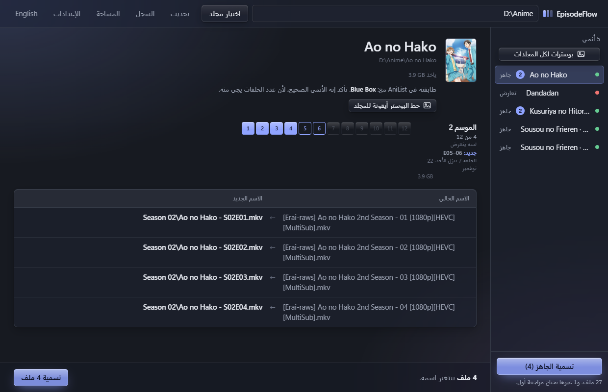

### بوستر الأنمي أيقونة للمجلد
بضغطة وحدة، أو ضغطة وحدة لكل المجلدات، يصير كل مجلد أنمي في الويندوز بالبوستر حقه.

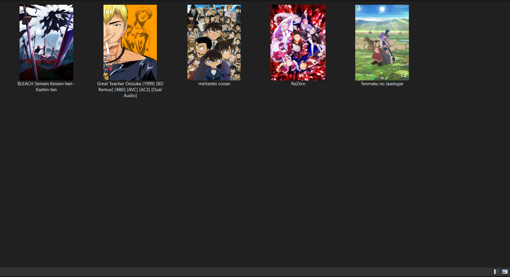

### نسختين من نفس الحلقة
البرنامج يوريك النسختين بجودتها وحجمها، ويقترح الأفضل. تقدر تخلي الثنتين (وتنضاف الجودة للاسم)، أو تخلي وحدة والثانية تروح سلة المحذوفات. ودايماً يسألك قبل، ولو القرص ما فيه سلة محذوفات (فلاشة أو قرص شبكة) ما يحذف شي.

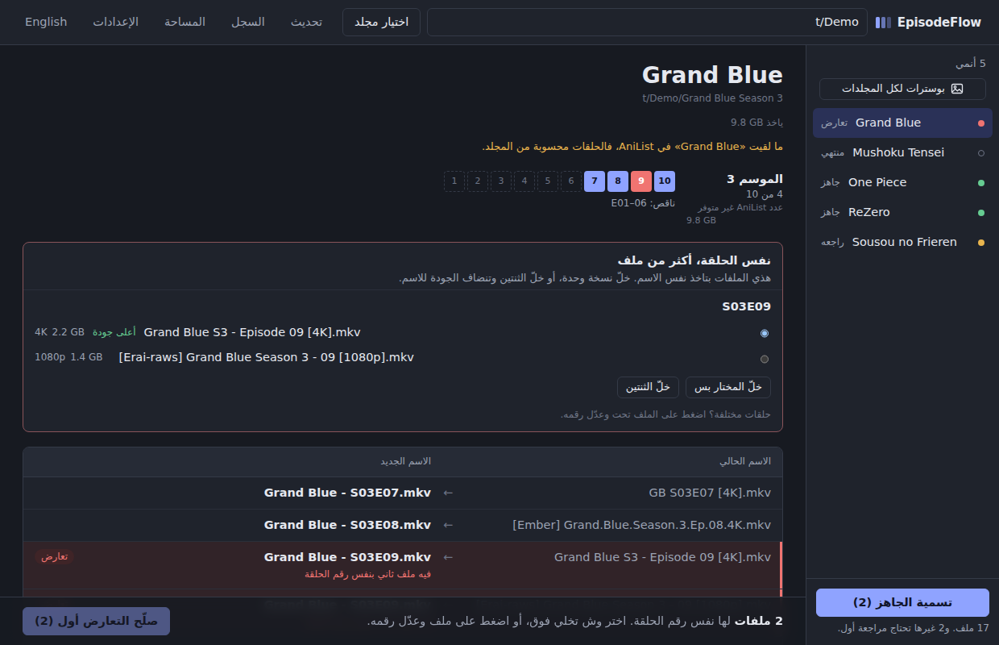

### ثيمات وزجاج
خمس ثيمات من **الإعدادات** ثم **«المظهر»**: مثل الويندوز، وفاتح، وداكن، و**OLED** (أسود صافي، فبكسلات شاشات OLED تطفي)، و**شفق** (كحلي غامق وألوان ناعمة ورا الزجاج). الأزرار واللوحات زجاج مضبّب، وتختار من خمس ألوان أساسية. وتقدر تطفي الزجاج لو حسيت النافذة ثقيلة على جهاز قديم.

| OLED | شفق |
|---|---|
| 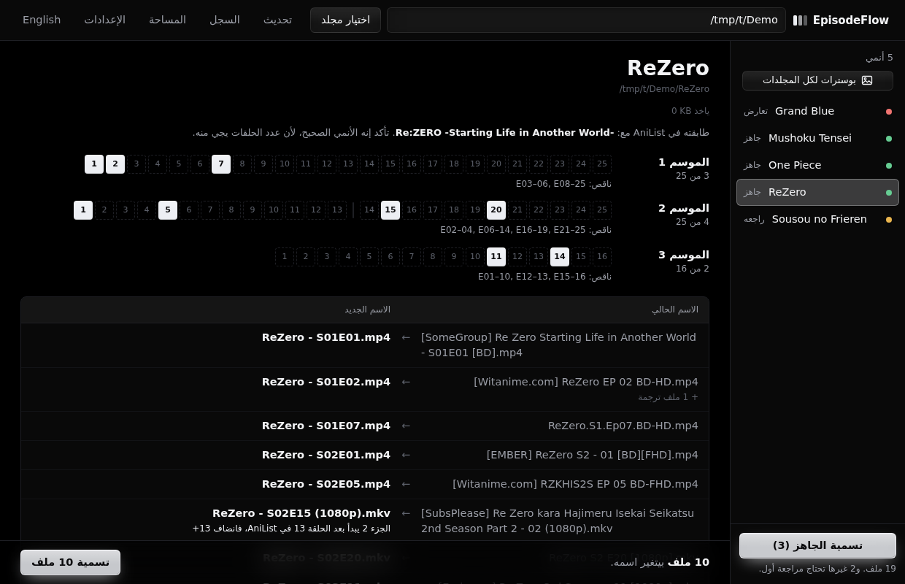 | 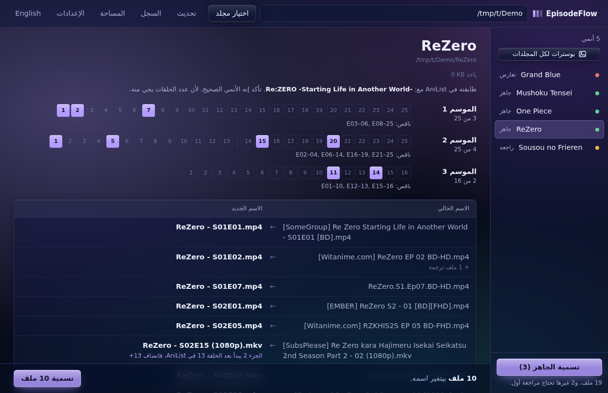 |

### وغيرها
- **أكثر من أنمي مرة وحدة:** افتح مجلد فيه مجلدات أنميات، وسمّ كل الجاهز منها بضغطة.
- **الحلقات المزدوجة:** الملف اللي فيه حلقتين يتسمى `S01E05-E06`، بالطريقة اللي يقرأها Plex و Jellyfin.
- **الحلقات الخاصة:** الـ OVA و OAD و SP والحلقات اللي رقمها ونص (مثل 12.5) تروح للموسم 0.
- **الترجمات تمشي معها:** ملفات `.srt` و `.ass` و `.ar.srt` تتسمى (وتنتقل) مع حلقتها.
- **سجل وتراجع:** كل تسمية محفوظة، وتقدر تتراجع عن أي وحدة حتى بعدين. ولو صار شي في النص (ملف مفتوح في المشغّل)، ما يتغير ولا شي.
- **شكل الاسم اللي تبيه:** `Show - S01E05` أو `S01E05` أو `Show - 05` أو `Show - 1x05`، أو تكتب شكلك الخاص.
- **المساحة:** كم ياخذ كل أنمي وكل موسم، وأكبر الملفات عندك.
- **السحب والإفلات:** اسحب المجلد على النافذة، أو كليك يمين على المجلد ثم **Send to** ثم **EpisodeFlow**.
- **عربي وإنجليزي**، والبرنامج يتذكر لغتك والثيم اللي اخترته.

| السجل | المساحة |
|---|---|
| 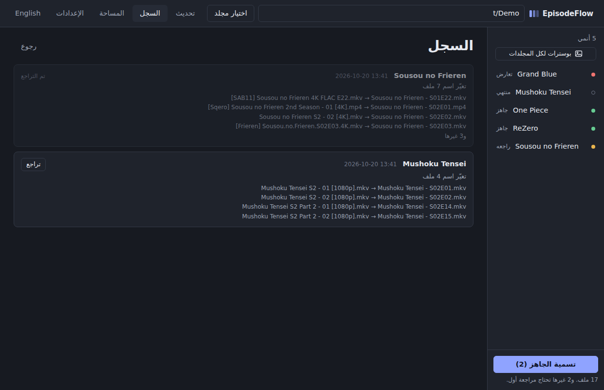 | 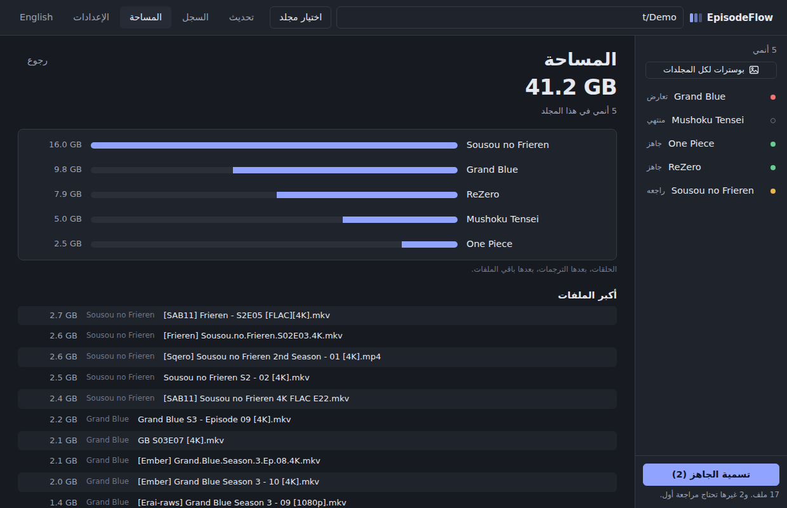 |

| الإعدادات | الواجهة بالإنجليزي |
|---|---|
| 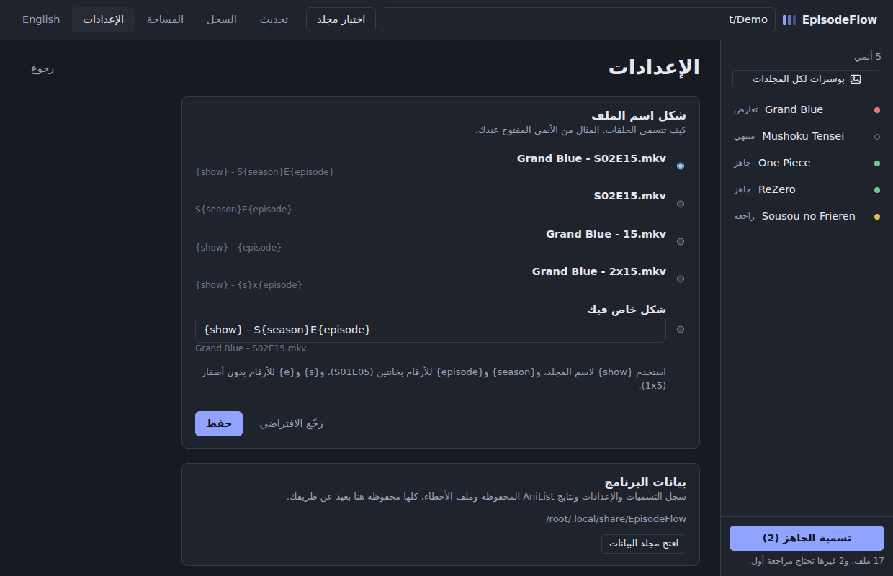 | 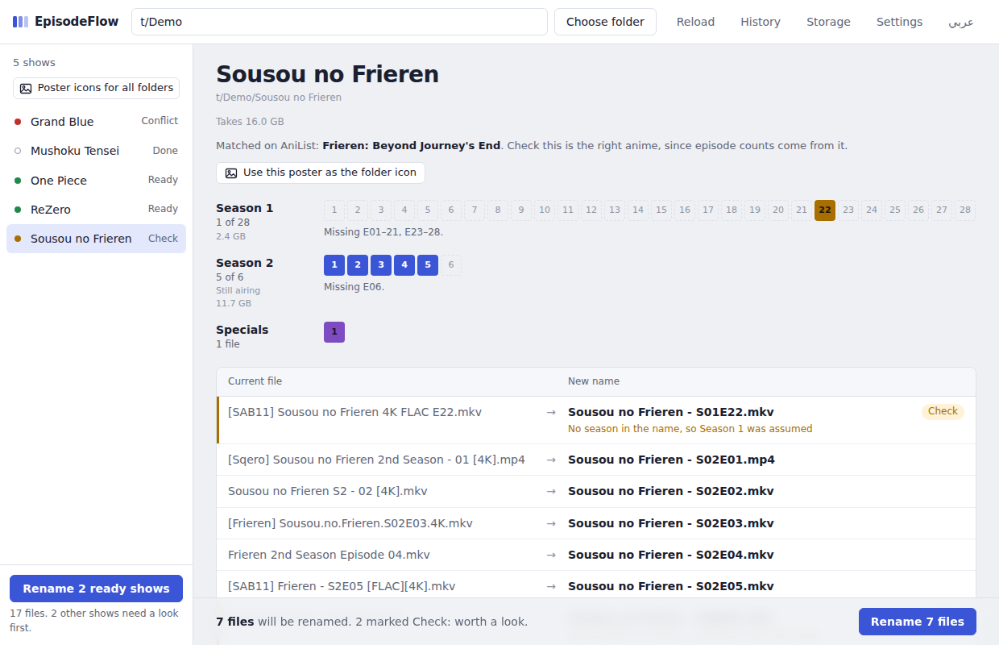 |

---

## التحميل والاستخدام

ويندوز 10 أو 11. من [آخر إصدار](../../releases/latest) حمّل واحد من هذول:

| | `EpisodeFlow-Setup.exe` | `EpisodeFlow.exe` |
|---|---|---|
| وش هو | مثبّت | بورتبل، ما يحتاج تثبيت |
| وين ينحط | مجلد المستخدم حقك (ما يحتاج صلاحيات مدير) | وين ما تبي، حتى في التنزيلات |
| الاختصارات | قائمة ابدأ وسطح المكتب و Send To، تختارها في المثبّت | يسألك أول مرة تفتحه |
| التحديث | شغّل Setup الجديد ويحل محل القديم | حط `EpisodeFlow.exe` الجديد مكان القديم |
| الإزالة | إعدادات الويندوز ثم التطبيقات، أو من داخل البرنامج | من داخل البرنامج: الإعدادات ثم «إزالة من الجهاز» |

الاثنين يحفظون سجلك وإعداداتك في نفس المكان، فتقدر تنقل من واحد للثاني.

> **طلع لك "Windows protected your PC"؟** البرنامج مجاني ومو موقّع، فالويندوز ينبّه عليه أول مرة. اضغط **More info** ثم **Run anyway**.

تبي تتأكد من الملف اللي حمّلته؟ كل إصدار فيه ملف `SHA256SUMS.txt`، وقارنه بـ `certutil -hashfile EpisodeFlow-Setup.exe SHA256` (أو `EpisodeFlow.exe`).

**التسمية:**
1. اسحب مجلد الأنمي على النافذة، أو اضغط **«اختيار مجلد»**، أو كليك يمين على المجلد ثم **Send to** ثم **EpisodeFlow**.
2. راجع الأسماء الجديدة. وتقدر تضغط على أي ملف وتعدّل موسمه أو حلقته.
3. اضغط **«تسمية»**. وغيّرت رأيك؟ اضغط **«تراجع»**.

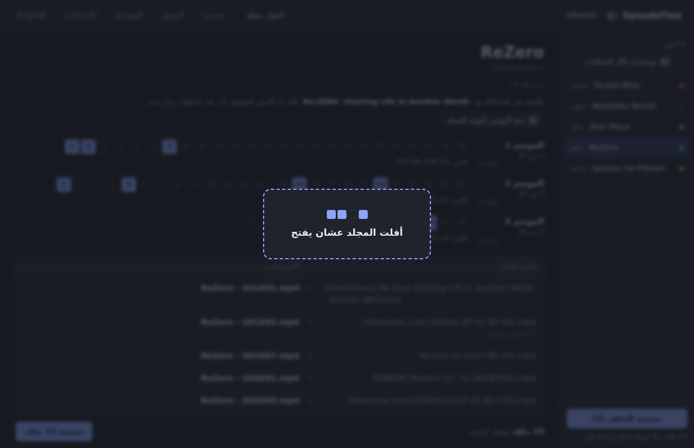

نصيحة: سمّ كل مجلد باسم الأنمي (`Sousou no Frieren` مو `SNF`) عشان AniList يلقى الأنمي الصحيح. والمجلد الواحد يقدر يكون فيه أكثر من موسم، أو مجلد `Season 1` و `Season 2` لكل موسم.

اللغة: الواجهة تفتح بالإنجليزي، وفيه زر **«عربي»** فوق يقلبها، والبرنامج يتذكر اختيارك.

---

## أسئلة

<b>يغيّر ملفات الفيديو أو يعيد ترميزها؟</b>

لا. يغيّر أسماءها بس (وينقلها لمجلدات المواسم لو شغّلت الخيار). الفيديو نفسه ما يفتحه ولا يغيّر فيه شي.

<b>يحتاج نت؟</b>

بس عشان يسأل AniList عن الأنمي: عدد المواسم والأجزاء، وأي الحلقات نزلت، والبوسترات لأيقونات المجلدات. وبدون نت يسمّي عادي ويعد الحلقات من المجلد، ويستخدم اللي حفظه من AniList قبل.

<b>AniList اختار أنمي غلط، وش أسوي؟</b>

سمّ المجلد باسم الأنمي الكامل (الاسم بالروماجي اللي في AniList هو الأفضل) واضغط **«تحديث»**. وتقدر بعد تضغط على أي ملف وتحدد موسمه وحلقته بنفسك.

<b>يشتغل مع Plex و Jellyfin و Kodi و VLC؟</b>

إي. `Show - S01E05.mkv` هي التسمية اللي يقرونها كلهم، و `S01E05-E06` هي الطريقة اللي يبونها للحلقات المزدوجة، ولو شغّلت مجلدات المواسم يصير الترتيب نفس اللي ينصح فيه Plex و Jellyfin.

<b>أقدر أتراجع عن تسمية سويتها من أسبوع؟</b>

إي. **«السجل»** فيه كل التسميات، وكل وحدة لها زر **«تراجع»**، بشرط إن الملفات لسا بالأسماء اللي عطاها البرنامج.

<b>فيه نسخة للماك أو لينكس؟</b>

لا، للحين. البرنامج مسوّى للويندوز (أيقونات المجلدات في المستكشف، وسلة المحذوفات، وقائمة Send To).

---

## الحذف

- **لو ثبّته بالـ Setup:** من **إعدادات الويندوز** ثم **التطبيقات** ثم **EpisodeFlow** ثم **Uninstall**، أو من داخل البرنامج **الإعدادات** ثم **«إزالة التثبيت»**. ويسألك تبي تخلي سجلك وإعداداتك أو لا.
- **البورتبل:** افتح البرنامج ثم **الإعدادات** ثم **«إزالة من الجهاز»**. يشيل الاختصارات، وسجلك وإعداداتك، وملف `EpisodeFlow.exe` نفسه.

**ملفات الأنمي حقتك ما تنلمس أبداً**: الملفات اللي تسمّت تبقى بأسمائها الجديدة. وأيقونات البوستر اللي حطيتها للمجلدات تبقى بعد. لو تبي تشيل وحدة، افتح الأنمي واضغط **«شيل الأيقونة»** قبل ما تزيل البرنامج.

حذف النسخة البورتبل يدوياً

1. احذف `EpisodeFlow.exe`.
2. احذف اختصار EpisodeFlow من سطح المكتب، ومن Send To (اضغط `Win + R` واكتب `shell:sendto`).
3. احذف البيانات: اضغط `Win + R` واكتب `%LOCALAPPDATA%\EpisodeFlow`.
4. أيقونات المجلدات (لو تبي): في كل مجلد أنمي، خلّ الملفات المخفية تبان واحذف `desktop.ini` و `EpisodeFlow-….ico`.

---

## الخصوصية والبيانات

البرنامج يشتغل على جهازك. وما يدخل النت إلا عشان يسأل AniList عن الأنمي، ويحمّل البوسترات لما تطلب أيقونات المجلدات. وسجلك وإعداداتك ونتايج AniList المحفوظة كلها في `%LOCALAPPDATA%\EpisodeFlow`، وتوصل لها من **الإعدادات** ثم **«افتح مجلد البيانات»**.

## المصادر

بيانات الأنمي والبوسترات من [AniList](https://anilist.co)، و EpisodeFlow ما له علاقة رسمية فيهم. والبرنامج يستخدم الـ API حقهم بأدب: الطلبات بينها مسافة، والنتايج تنحفظ كم يوم، فلو فتحت نفس المجلدات مرة ثانية ما يسألهم من جديد.

## البناء من الكود

يحتاج **Python 3.10 أو أحدث** على ويندوز. شغّل `build.bat`، ويحط أدوات البناء من `requirements-build.txt` (PyInstaller و pywebview بإصدارات ثابتة) في مجلد `.venv` جنبه بدون ما يلمس الـ Python حقك، ويطلّع `release\EpisodeFlow.exe`. ولو [NSIS](https://nsis.sourceforge.io) مثبّت عندك، يطلّع بعد `release\EpisodeFlow-Setup.exe` من `installer\EpisodeFlow.nsi`.

وتقدر تشغّله من الكود مباشرة بـ `python src\episodeflow_gui.py`.

**الاختبارات:** `python -m pip install -r requirements-dev.txt` وبعدها `python -m pytest`. تغطي قراءة الحلقات، ومواسم وأجزاء AniList والحلقات اللي نزلت (بـ AniList وهمي، فما يدخل النت)، والتسمية، والتراجع، ومجلدات المواسم، وأشكال الأسماء. وGitHub Actions يشغّلها مع كل رفع ويبني الملفين، ولما ينحط tag لإصدار جديد يرفعهم مع الإصدار ومعهم `SHA256SUMS.txt`.

لقيت مشكلة أو عندك فكرة؟ [افتح issue](../../issues/new/choose).

## التغييرات

شوف [CHANGELOG.md](CHANGELOG.md).

## الترخيص

[MIT](LICENSE)

