
<a href="README.md">English</a> | <b>العربية</b>

  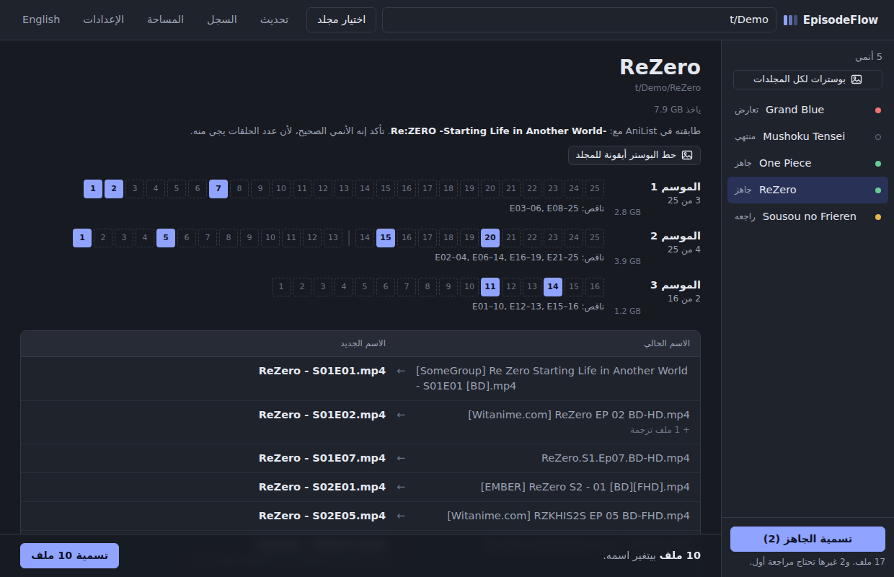

<h1 align="center">EpisodeFlow</h1>

  يرتّب أسماء حلقات الأنمي اللي تحمّلها من أي مكان، بحيث المشغّل يعرف دايماً وش الحلقة الجاية. 
  <code dir="ltr">[SubsPlease] Sousou no Frieren - 05 (1080p) [A1B2C3D4].mkv</code> ← <code dir="ltr">Sousou no Frieren - S02E05.mkv</code>

  <a href="../../releases/latest"><b>تحميل</b></a> ·
  <a href="#المزايا">المزايا</a> ·
  <a href="#التحميل-والاستخدام">التحميل والاستخدام</a> ·
  <a href="#الحذف">الحذف</a>

---

## المزايا

### يقرأ الأسماء اللي ما يقرأها غيره
حلقات من جروبات مختلفة في نفس المجلد؟ اختصارات مثل `RZKHIS2SP2` و `Season 3 - 10` و `4x22` و `Ep.08`، أو أكواد غريبة، أو نسخ مكررة مثل `(1)`، أو `[4K]` و `FLAC`؟ البرنامج يعرف الموسم والحلقة الصحيحة لكل ملف، و**يحافظ على أرقام الحلقات الحقيقية**، يعني الحلقات من 3 إلى 12 تبقى من 3 إلى 12. وأي ملف مو متأكد منه يحط عليه علامة **«راجعه»** عشان تشيك عليه قبل التسمية. وما يتغير أي اسم إلا لما تضغط **«تسمية»**.

### يعرف كل المواسم والأجزاء من AniList
جزء ثاني (Part 2 أو Cour 2) أرقامه تبدأ من 1؟ البرنامج يسأل [AniList](https://anilist.co) كم حلقة قبله ويكمل العد. مثلاً الحلقة 2 من الجزء الثاني من الموسم الثاني في Re:Zero تصير `S02E15`. ويضبط حتى لو ما عندك ولا حلقة من الجزء الأول.

### تشوف الناقص بنظرة وحدة
كل موسم له شريط حلقات (شوف الصورة اللي فوق): المربع المعبّى حلقة عندك، والمنقّط حلقة ناقصة، وفيه خط يوضح وين يبدأ الجزء الثاني.

والأنميات الطويلة مثل ون بيس والمحقق كونان، يوريك فيها الحلقات اللي عندك بس، مقسّمة لمجموعات، مع عدد الحلقات اللي بينها:

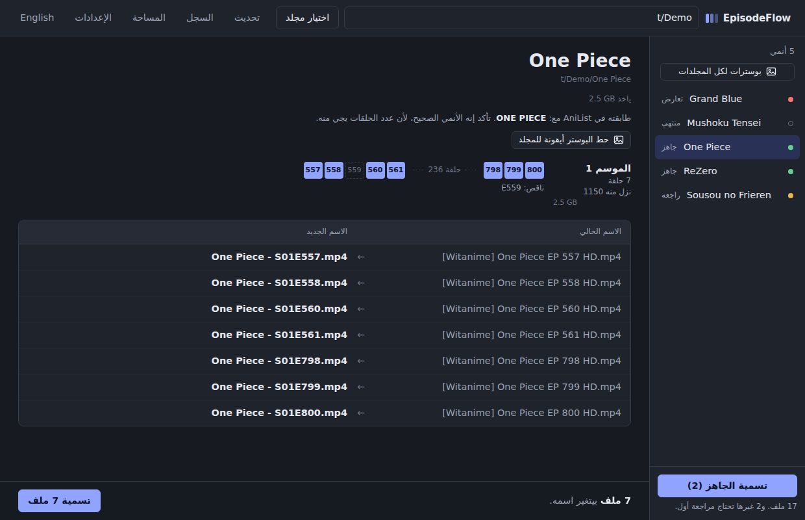

### بوستر الأنمي أيقونة للمجلد
بضغطة وحدة، أو ضغطة وحدة لكل المجلدات، يصير كل مجلد أنمي في الويندوز بالبوستر حقه.

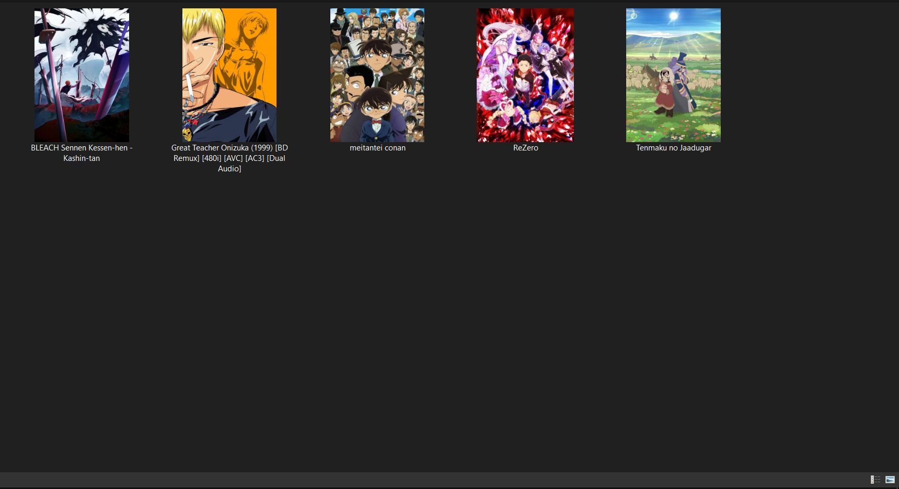

### نسختين من نفس الحلقة
البرنامج يوريك النسختين بجودتها وحجمها، ويقترح الأفضل. تقدر تخلي الثنتين (وتنضاف الجودة للاسم)، أو تخلي وحدة والثانية تروح سلة المحذوفات. ودايماً يسألك قبل.

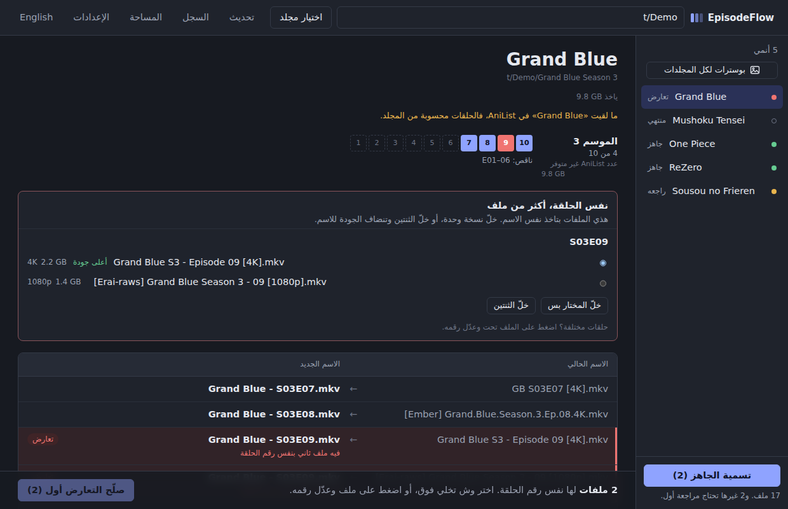

### ثيمات وزجاج
خمس ثيمات من **الإعدادات** ثم **«المظهر»**: مثل الويندوز، وفاتح، وداكن، و**OLED** (أسود صافي، فبكسلات شاشات OLED تطفي)، و**شفق** (كحلي غامق وألوان ناعمة ورا الزجاج). الأزرار واللوحات زجاج مضبّب، وتختار من خمس ألوان أساسية. وتقدر تطفي الزجاج لو حسيت النافذة ثقيلة على جهاز قديم.

| OLED | شفق |
|---|---|
| 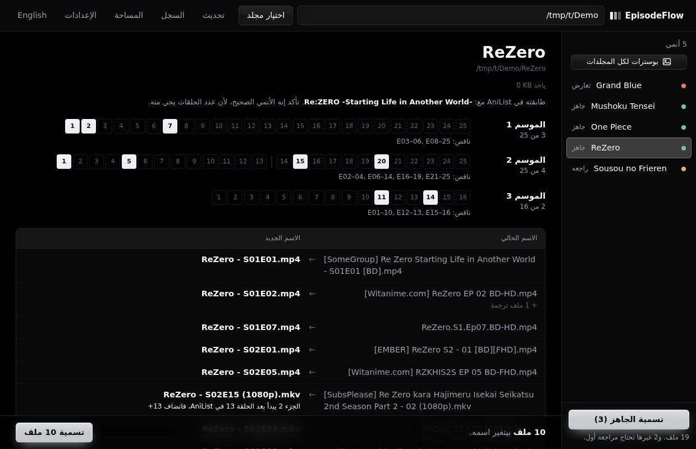 | 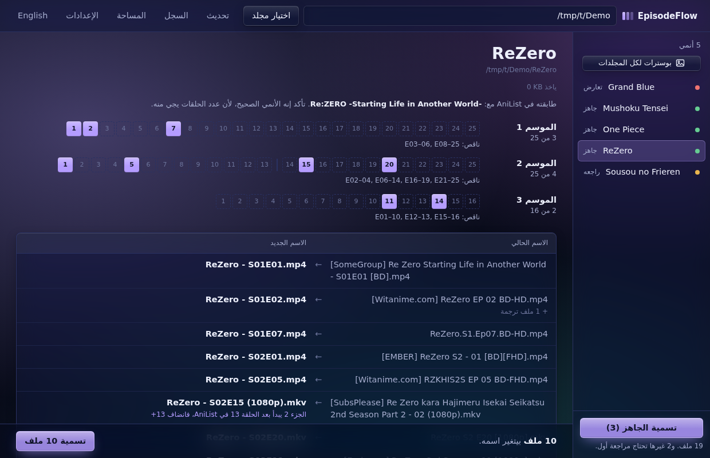 |

### وغيرها
- **أكثر من أنمي مرة وحدة:** افتح مجلد فيه مجلدات أنميات، وسمّ كل الجاهز منها بضغطة.
- **الحلقات الخاصة:** الـ OVA و OAD و SP والحلقات اللي رقمها ونص (مثل 12.5) تروح للموسم 0.
- **الترجمات تمشي معها:** ملفات `.srt` و `.ass` و `.ar.srt` تتسمى مع حلقتها.
- **سجل وتراجع:** كل تسمية محفوظة، وتقدر تتراجع عن أي وحدة حتى بعدين.
- **شكل الاسم اللي تبيه:** `Show - S01E05` أو `S01E05` أو `Show - 05` أو `Show - 1x05`، أو تكتب شكلك الخاص.
- **المساحة:** كم ياخذ كل أنمي وكل موسم، وأكبر الملفات عندك.
- **السحب والإفلات:** اسحب المجلد على النافذة، أو كليك يمين على المجلد ثم **Send to** ثم **EpisodeFlow**.
- **عربي وإنجليزي**، والبرنامج يتذكر لغتك والثيم اللي اخترته.

| السجل | المساحة |
|---|---|
| 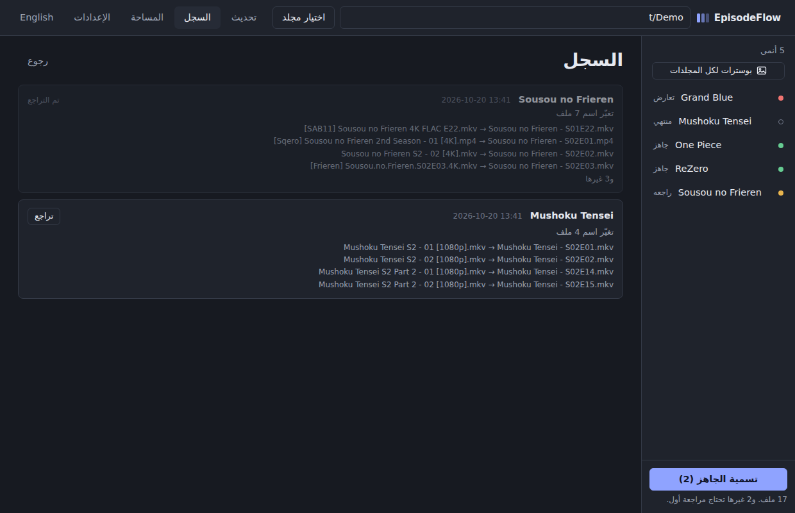 | 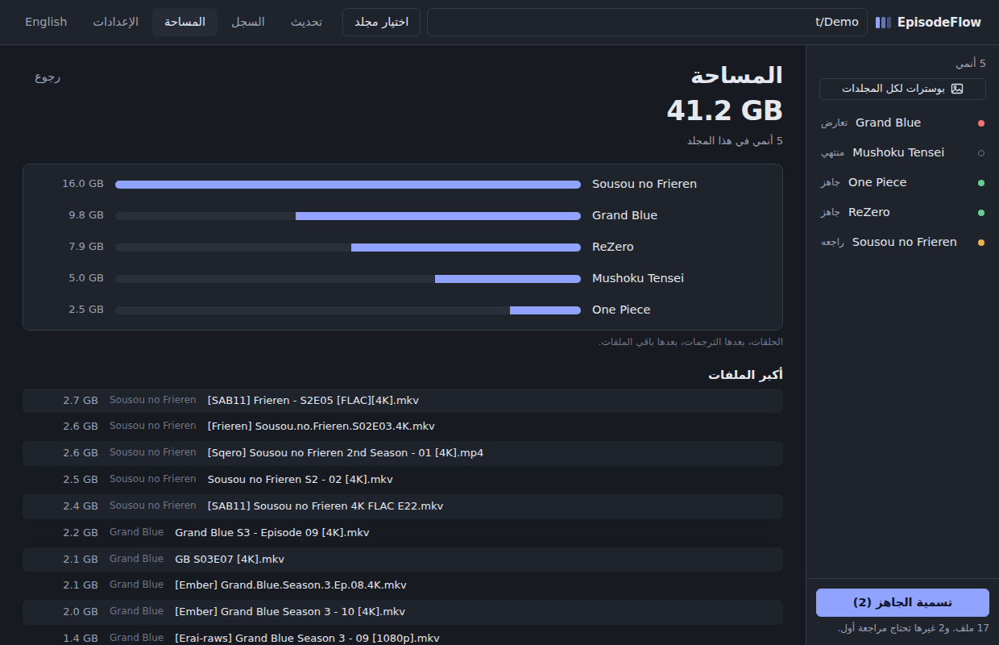 |

| الإعدادات | الواجهة بالإنجليزي |
|---|---|
| 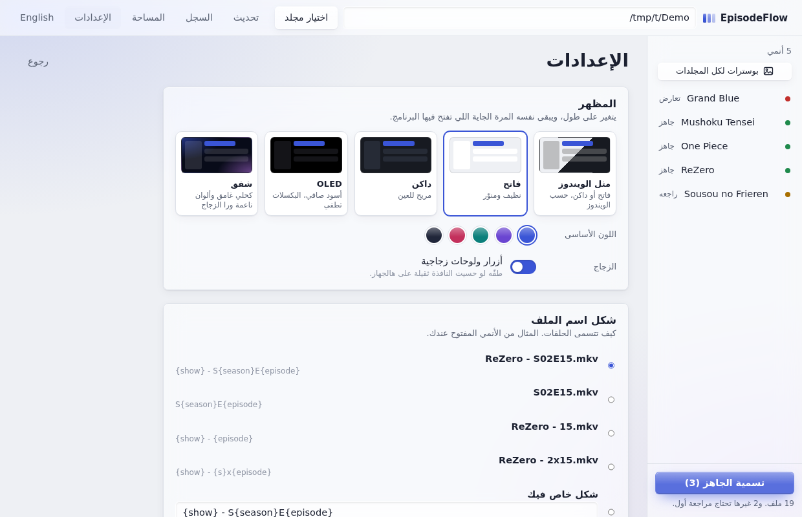 | 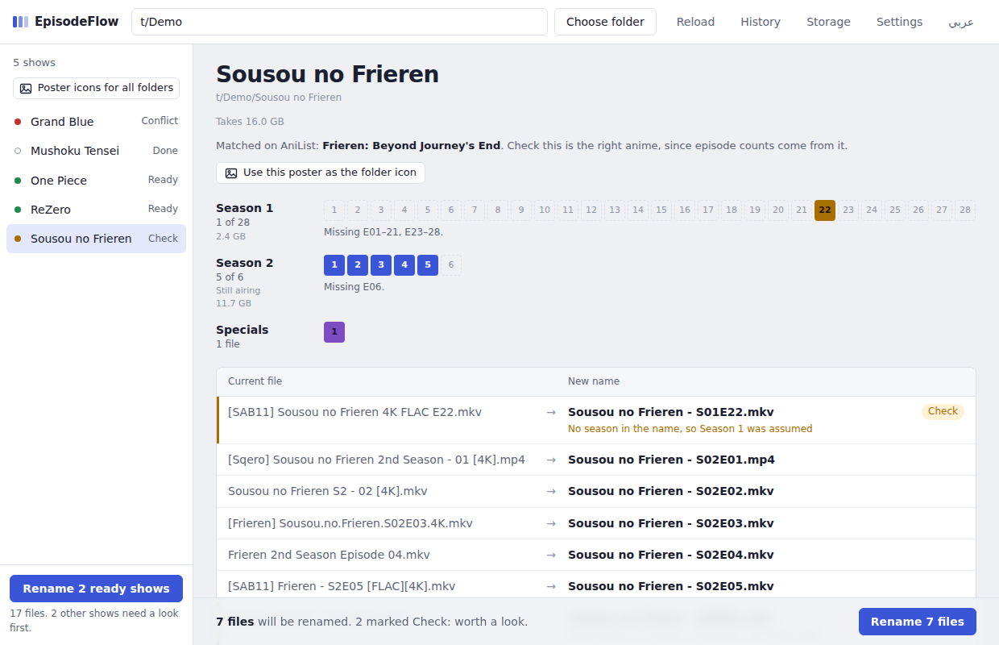 |

---

## التحميل والاستخدام

ويندوز 10 أو 11.

1. حمّل **`EpisodeFlow.exe`** من [آخر إصدار](../../releases/latest).
2. حطه وين ما تبي، حتى في التنزيلات، وافتحه. ما يحتاج تثبيت، وما يسوي أي ملفات جنبه.
3. أول مرة يسألك: تبي تضيف EpisodeFlow **لسطح المكتب** وقائمة **Send To**؟ وافق، وبعدها تقدر تفتح أي مجلد أنمي بكليك يمين.

> **طلع لك "Windows protected your PC"؟** البرنامج مجاني ومو موقّع، فالويندوز ينبّه عليه أول مرة. اضغط **More info** ثم **Run anyway**.

**التسمية:**
1. اسحب مجلد الأنمي على النافذة، أو اضغط **«اختيار مجلد»**، أو كليك يمين على المجلد ثم **Send to** ثم **EpisodeFlow**.
2. راجع الأسماء الجديدة. وتقدر تضغط على أي ملف وتعدّل موسمه أو حلقته.
3. اضغط **«تسمية»**. وغيّرت رأيك؟ اضغط **«تراجع»**.

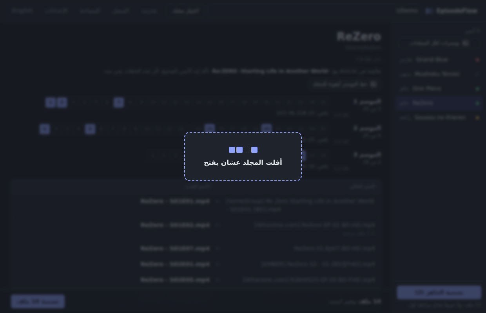

نصيحة: سمّ كل مجلد باسم الأنمي (`Sousou no Frieren` مو `SNF`) عشان AniList يلقى الأنمي الصحيح. والمجلد الواحد يقدر يكون فيه أكثر من موسم.

اللغة: الواجهة تفتح بالإنجليزي، وفيه زر **«عربي»** فوق يقلبها، والبرنامج يتذكر اختيارك.

---

## الحذف

افتح البرنامج ثم **الإعدادات** ثم **«إزالة من الجهاز»**. يشيل الاختصارات، وسجلك وإعداداتك، وملف `EpisodeFlow.exe` نفسه.

**ملفات الأنمي حقتك ما تنلمس أبداً**: الملفات اللي تسمّت تبقى بأسمائها الجديدة.

الحذف يدوياً

1. احذف `EpisodeFlow.exe`.
2. احذف اختصار EpisodeFlow من سطح المكتب، ومن Send To (اضغط `Win + R` واكتب `shell:sendto`).
3. احذف البيانات: اضغط `Win + R` واكتب `%LOCALAPPDATA%\EpisodeFlow`.

---

## الخصوصية والبيانات

البرنامج يشتغل على جهازك. وما يدخل النت إلا عشان يسأل AniList عن الأنمي، ويحمّل البوسترات لما تطلب أيقونات المجلدات. وسجلك وإعداداتك ونتايج AniList المحفوظة كلها في `%LOCALAPPDATA%\EpisodeFlow`، وتوصل لها من **الإعدادات** ثم **«افتح مجلد البيانات»**.

## المصادر

بيانات الأنمي والبوسترات من [AniList](https://anilist.co)، و EpisodeFlow ما له علاقة رسمية فيهم. والبرنامج يستخدم الـ API حقهم بأدب: الطلبات بينها مسافة، والنتايج تنحفظ كم يوم، فلو فتحت نفس المجلدات مرة ثانية ما يسألهم من جديد.

## البناء من الكود

يحتاج Python 3 على ويندوز. شغّل `build.bat`، ويثبّت أدوات البناء (PyInstaller و pywebview) ويطلّع `release\EpisodeFlow.exe`.

وتقدر تشغّله من الكود مباشرة بـ `python src\episodeflow_gui.py`، وتختبر قراءة الحلقات بـ `python tests\test_detection.py`.

## الترخيص

[MIT](LICENSE)

