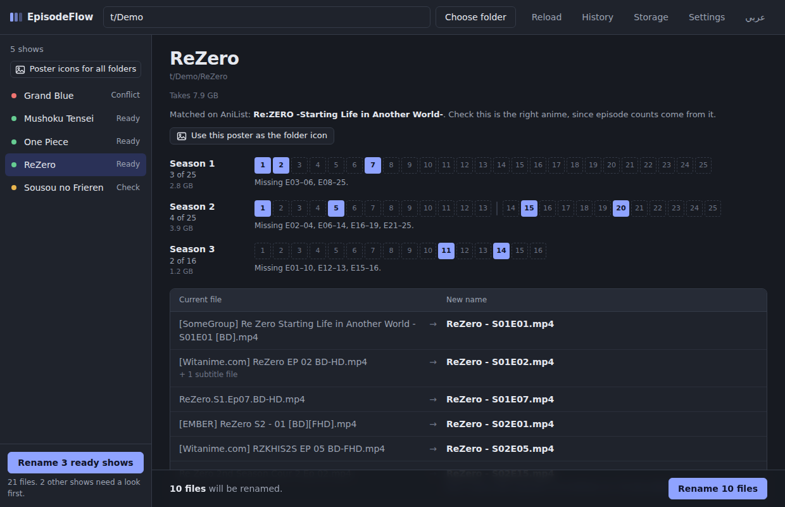
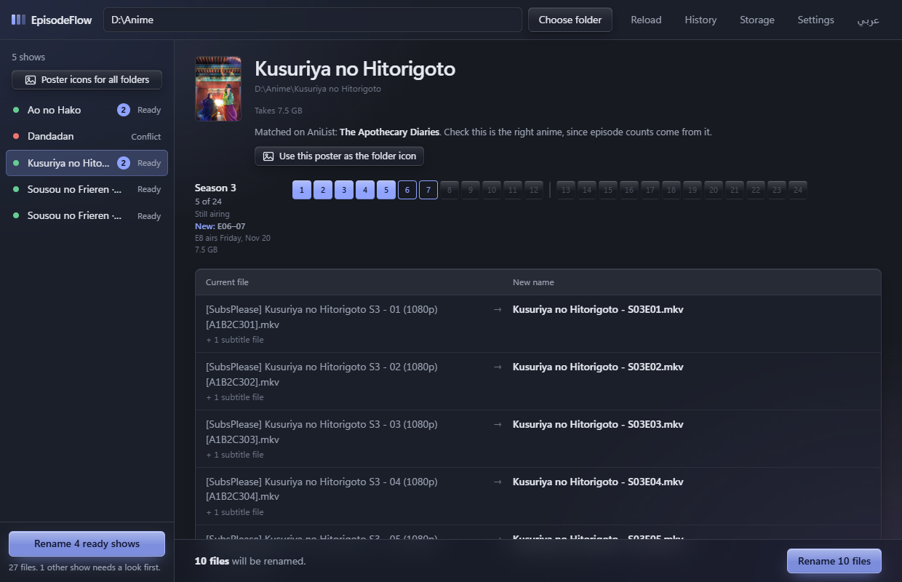
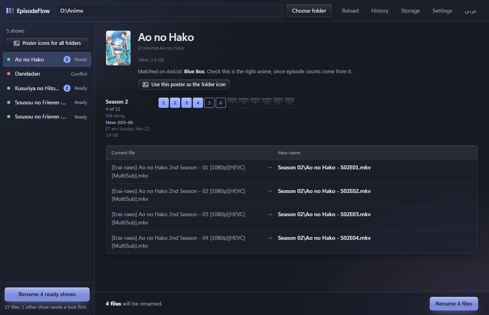
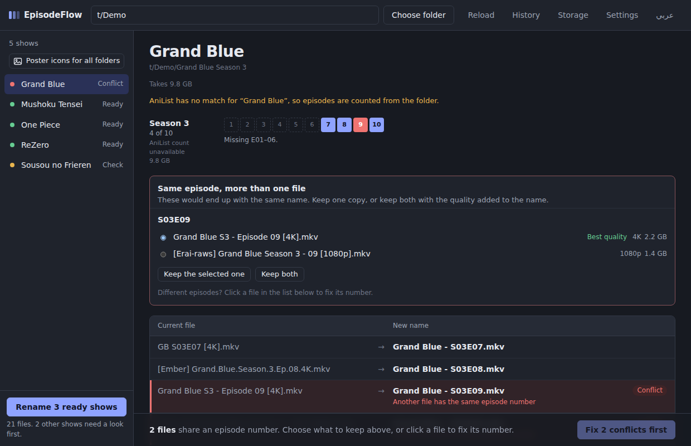
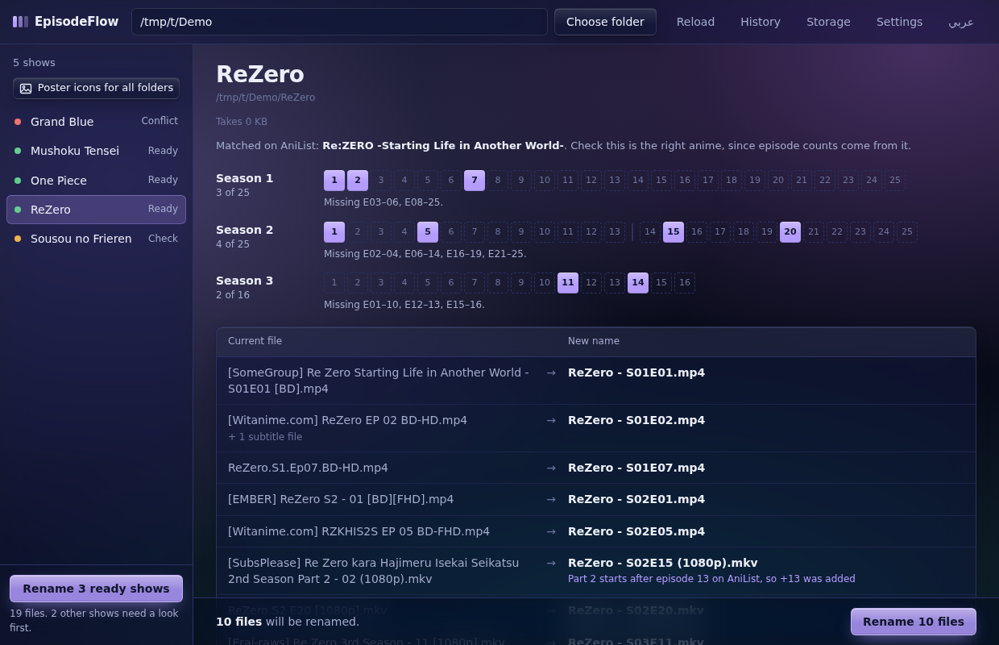
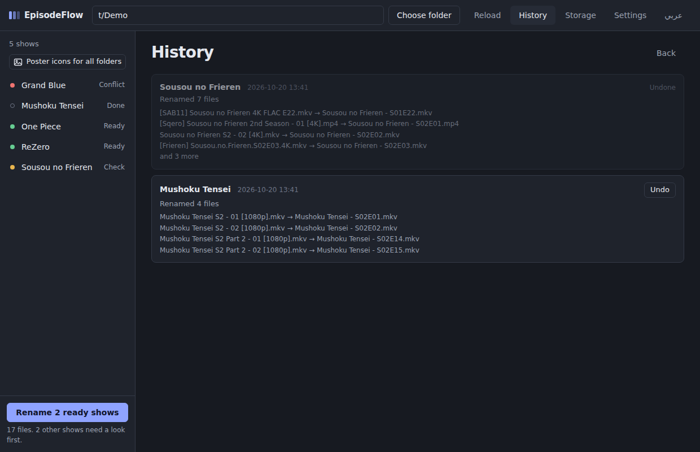
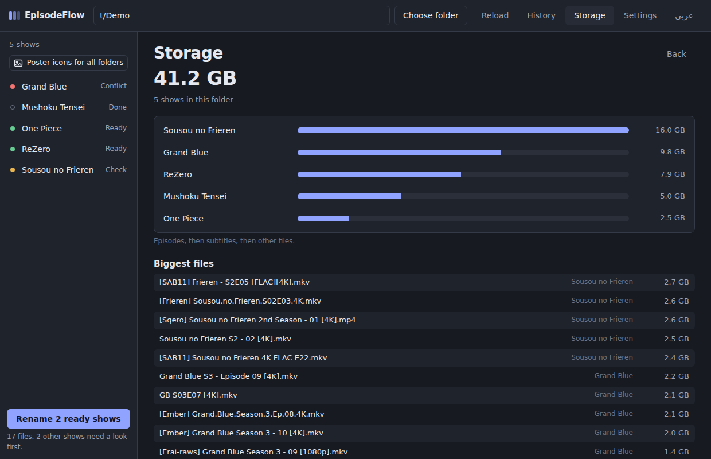
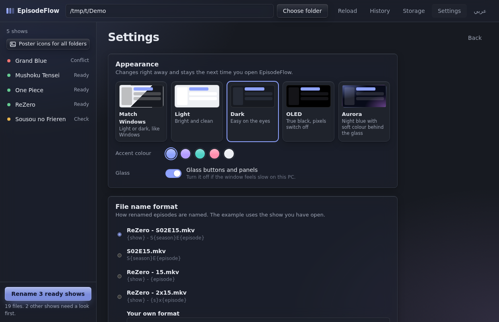
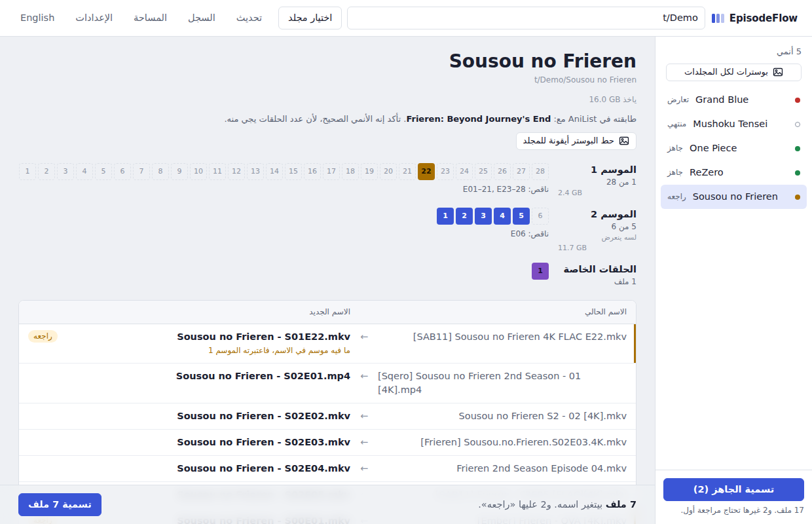

<b>English</b> | <a href="README.ar.md">العربية</a>

  

<h1 align="center">EpisodeFlow</h1>

  Turn messy anime downloads into clean, ordered episodes, so your player always knows what comes next. 
  <code>[SubsPlease] Sousou no Frieren - 05 (1080p) [A1B2C3D4].mkv</code> → <code>Sousou no Frieren - S02E05.mkv</code>

  
  
  
  
  

  <a href="../../releases/latest"><b>Download</b></a> ·
  <a href="#features">Features</a> ·
  <a href="#download-and-use">Download and use</a> ·
  <a href="#questions">Questions</a> ·
  <a href="#remove-it">Remove it</a>

---

## New in 1.2.0

- **New episodes at a glance:** for shows still airing, EpisodeFlow shows which episodes are already out that you don't have yet, and when the next one airs.
- **Season folders:** optionally moves episodes into `Season 01`, `Season 02` and `Specials`, the layout Plex and Jellyfin expect. Undo puts them back.
- **Installer:** pick `EpisodeFlow-Setup.exe` (Start menu, uninstall from Windows Settings) or the portable `EpisodeFlow.exe`, as before.
- Plus fixes for season folders, double episodes (`S01E05-E06`), `v2` files and more. See the [changelog](CHANGELOG.md).

## Features

### Reads the names nobody else can
Episodes from different groups in one folder? Abbreviations like `RZKHIS2SP2`, `Season 3 - 10`, `4x22`, `Ep.08`, `S01E05v2`, `第05話`, hashes, `(1)` copies, `[4K]`, `FLAC`? EpisodeFlow works out the right season and episode for each file and keeps the **real episode numbers** (episodes 3 to 12 stay 3 to 12). Anything it isn't sure about is marked **Check** so you can look before renaming. Nothing changes until you press **Rename**.

### Knows every season and part, thanks to AniList
Part 2 / Cour 2 that restarts at episode 1? EpisodeFlow asks [AniList](https://anilist.co) how many episodes came before and continues the count (Re:Zero Season 2 Part 2, episode 2 becomes `S02E15`). It works even if you don't have a single episode of the first part.

### See what's missing, and what's new
Every season gets an episode strip: filled squares are episodes you have, dashed ones are missing, and a line marks where Part 2 starts. For a show that's still airing, episodes that are out but not in your folder are marked **New**, the ones not out yet are faded, and you see when the next one airs. The list on the left shows how many new episodes each show has.

Long-running shows like One Piece or Detective Conan only show the episodes you have, grouped, with the gap in between:

### Season folders for Plex and Jellyfin
Turn on **Settings → File name format → Also move episodes into season folders**, and renamed episodes go into `Season 01`, `Season 02` and `Specials` inside the show's folder. Undo moves them back and removes the folders it made. Folders that are already laid out like this (`Frieren/Season 1`, `Frieren/Specials`) are read as one show, each with the right season.

### The anime poster as the folder icon
One click (or one click for all folders) and Windows shows each anime folder with its poster.

### Two copies of the same episode
EpisodeFlow shows both with their quality and size and suggests the better one. Keep both (the quality is added to the name), or keep one and move the other to the Recycle Bin. It always asks first, and on a drive with no Recycle Bin (a USB stick, a network drive) it doesn't delete anything.

### Themes and glass
Five themes in **Settings → Appearance**: Match Windows, Light, Dark, **OLED** (true black, so OLED pixels switch off) and **Aurora** (night blue with soft colour behind the glass). Buttons and panels are frosted glass, and there are five accent colours to pick from. Glass can be turned off if the window feels slow on an older PC.

| OLED | Aurora |
|---|---|
|  |  |

### Everything else
- **Many shows at once:** open a folder that has anime folders inside, and rename all the ready ones in one go.
- **Double episodes:** a file with two episodes in it is named `S01E05-E06`, the way Plex and Jellyfin read it.
- **Specials:** OVA, OAD, SP and `12.5` episodes go to Season 0.
- **Subtitles follow:** `.srt`, `.ass` and `.ar.srt` files are renamed (and moved) with their episode.
- **History and undo:** every rename is kept, and any of them can be undone later. If something goes wrong halfway (a file open in your player), nothing is changed at all.
- **Your own name format:** `Show - S01E05`, `S01E05`, `Show - 05`, `Show - 1x05`, or write your own.
- **Storage:** how much space each show and season takes, and your biggest files.
- **Drag and drop** a folder onto the window, or right-click a folder and use **Send to → EpisodeFlow**.
- **English and Arabic.** Your language and theme are remembered between runs.

| History | Storage |
|---|---|
|  |  |

| Settings | Arabic interface |
|---|---|
|  |  |

---

## Download and use

Windows 10 or 11. From the [latest release](../../releases/latest), download one of:

| | `EpisodeFlow-Setup.exe` | `EpisodeFlow.exe` |
|---|---|---|
| What it is | Installer | Portable, nothing to install |
| Where it goes | Your user folder (no admin needed) | Anywhere you like, even Downloads |
| Shortcuts | Start menu, Desktop and Send To, picked in the installer | Asks the first time you open it |
| Updating | Run the new Setup, it replaces the old version | Replace the old `EpisodeFlow.exe` |
| Removing | Windows Settings → Apps, or in EpisodeFlow | In EpisodeFlow: Settings → Remove from this PC |

Both keep your history and settings in the same place, so you can switch between them.

> **"Windows protected your PC"?** EpisodeFlow is free and not code-signed, so Windows warns about it the first time. Click **More info**, then **Run anyway**.

Want to check the download? Each release has a `SHA256SUMS.txt`. Compare it with `certutil -hashfile EpisodeFlow-Setup.exe SHA256` (or `EpisodeFlow.exe`).

**Renaming:**
1. Drag an anime folder onto the window, click **Choose folder**, or right-click a folder → **Send to → EpisodeFlow**.
2. Check the new names. Click any file to change its season or episode.
3. Press **Rename**. Changed your mind? Press **Undo**.

Tip: name each folder after the anime (`Sousou no Frieren`, not `SNF`), so AniList finds the right show. One folder can hold several seasons, or a `Season 1` / `Season 2` folder each.

Language: the window opens in English. The **عربي** button at the top switches it to Arabic, and your choice is remembered.

---

## Questions

<b>Does it change or re-encode my video files?</b>

No. It only renames them (and moves them into season folders if you turn that on). The video itself is never opened or changed.

<b>Does it need the internet?</b>

Only to ask AniList about shows: season and part counts, which episodes are out, and posters for folder icons. Without internet it still renames, counting episodes from the folder, and uses what it saved from AniList earlier.

<b>AniList picked the wrong show. What now?</b>

Rename the folder to the anime's full name (the romaji title on AniList works best) and press **Reload**. You can also click any file to set its season and episode yourself.

<b>Does it work with Plex, Jellyfin, Kodi or VLC?</b>

Yes. `Show - S01E05.mkv` is the naming they all read, `S01E05-E06` is how they expect double episodes, and with season folders on, the layout is the one Plex and Jellyfin recommend.

<b>Can I undo a rename from last week?</b>

Yes. **History** keeps every rename, and each one has an **Undo** button, as long as the files still have the names EpisodeFlow gave them.

<b>Mac or Linux?</b>

Not at the moment: EpisodeFlow is made for Windows (Explorer folder icons, the Recycle Bin, the Send To menu).

---

## Remove it

- **Installed with Setup:** Windows **Settings → Apps → EpisodeFlow → Uninstall**, or in EpisodeFlow **Settings → Uninstall**. It asks whether to keep your history and settings.
- **Portable:** open EpisodeFlow → **Settings** → **Remove from this PC**. It removes its shortcuts, your history and settings, and `EpisodeFlow.exe` itself.

**Your anime files are never touched**: renamed files keep their new names. Poster folder icons you set stay too. To remove one, open that show and press **Remove folder icon** before removing EpisodeFlow.

Removing the portable version by hand

1. Delete `EpisodeFlow.exe`.
2. Delete the EpisodeFlow shortcut from the Desktop, and from Send To (`Win + R` → `shell:sendto`).
3. Delete your data: `Win + R` → `%LOCALAPPDATA%\EpisodeFlow`.
4. Folder icons (optional): in each anime folder, show hidden files and delete `desktop.ini` and `EpisodeFlow-….ico`.

---

## Privacy and data

EpisodeFlow runs on your PC. It only goes online to ask AniList about shows (and to download posters when you ask for folder icons). Your history, settings and the saved AniList info are kept in `%LOCALAPPDATA%\EpisodeFlow`. **Settings → Open data folder** takes you there.

## Credits

Anime data and posters come from [AniList](https://anilist.co). EpisodeFlow is not affiliated with AniList. It uses AniList's public API politely: requests are spaced out and results are kept for a few days, so opening the same folders again doesn't ask AniList again.

## Build from source

Needs **Python 3.10 or newer** on Windows. Run `build.bat`: it puts the build tools from `requirements-build.txt` (PyInstaller and pywebview, pinned versions) into a `.venv` folder next to it, without touching your own Python, and creates `release\EpisodeFlow.exe`. With [NSIS](https://nsis.sourceforge.io) installed it also makes `release\EpisodeFlow-Setup.exe` from `installer\EpisodeFlow.nsi`.

You can also run it straight from the source with `python src\episodeflow_gui.py`.

**Tests:** `python -m pip install -r requirements-dev.txt`, then `python -m pytest`. They cover episode detection, AniList seasons, parts and airing (with a fake AniList, so nothing goes online), renaming, undo, season folders and the file name formats. GitHub Actions runs them on every push, builds both files, and on a version tag attaches them to the release with `SHA256SUMS.txt`.

Found a bug or have an idea? [Open an issue](../../issues/new/choose).

## Changes

See [CHANGELOG.md](CHANGELOG.md).

## License

[MIT](LICENSE)
