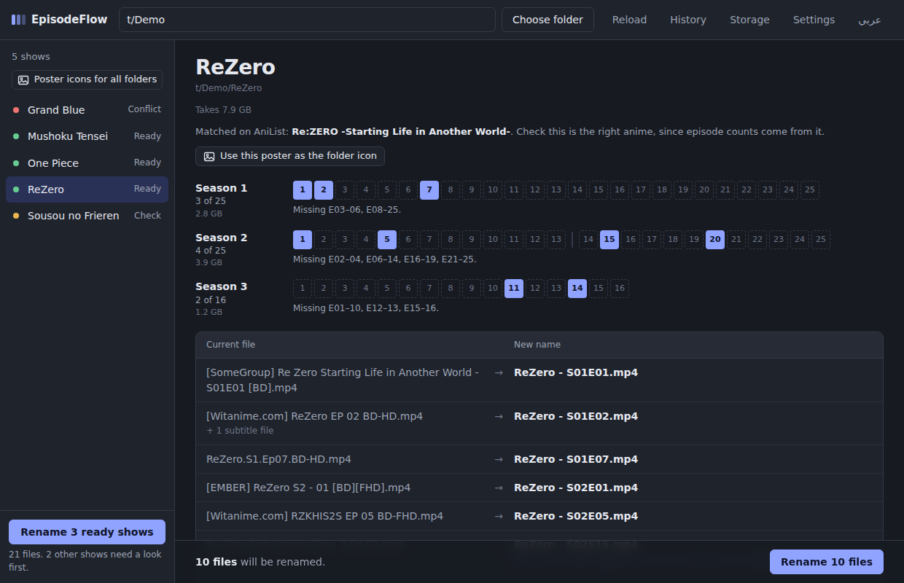
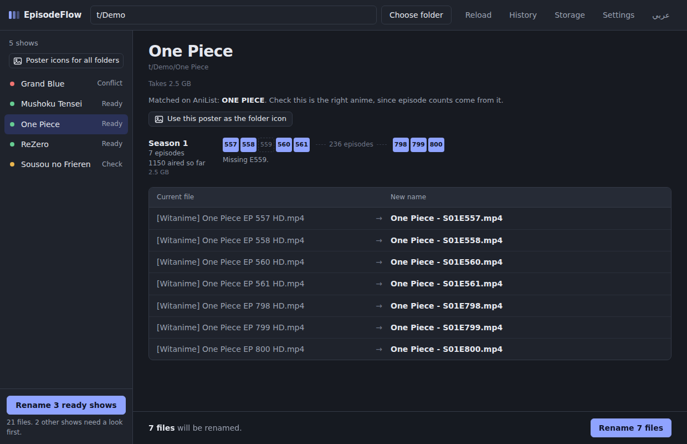
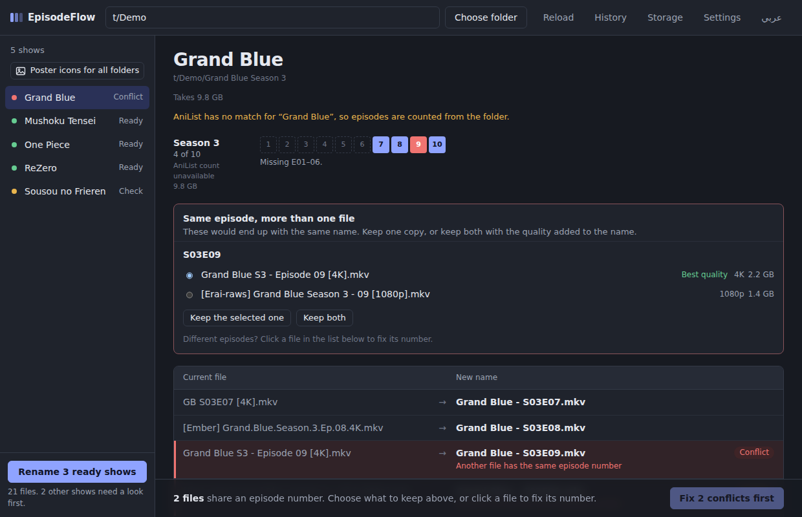
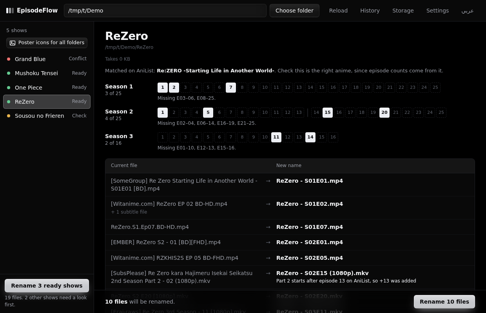
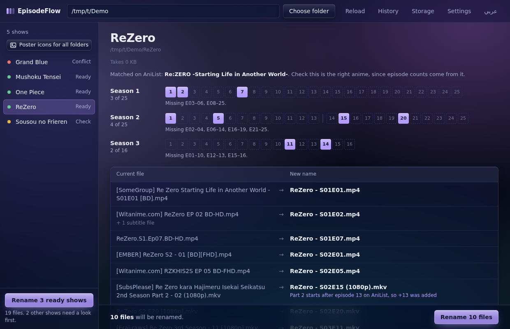
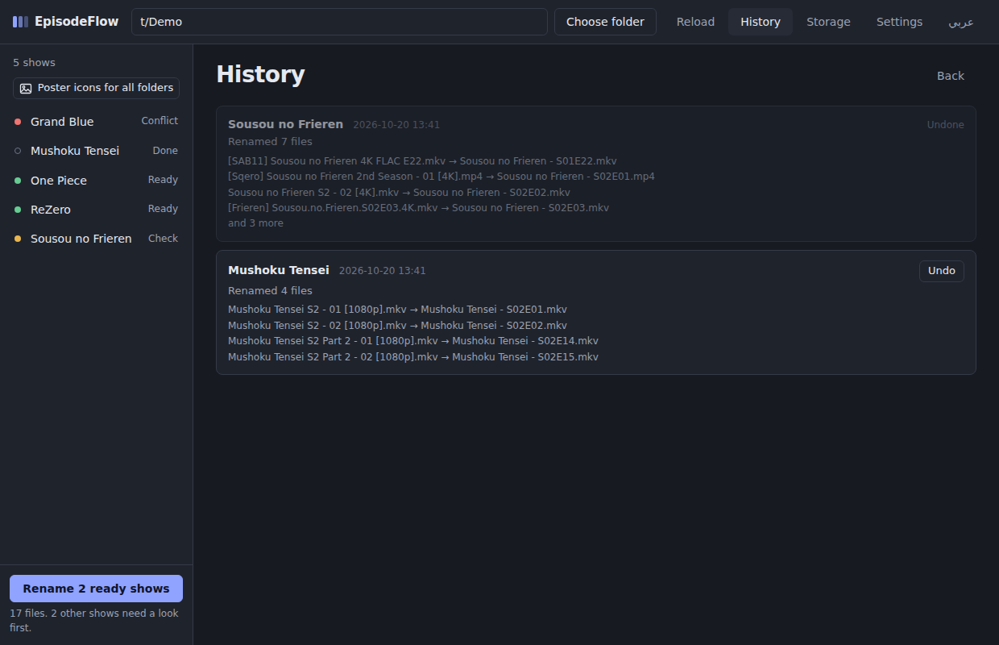
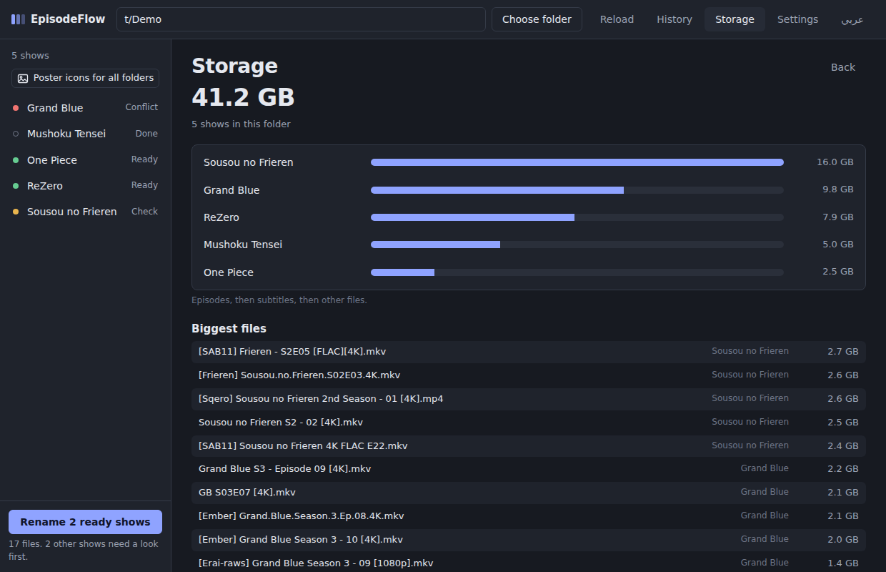
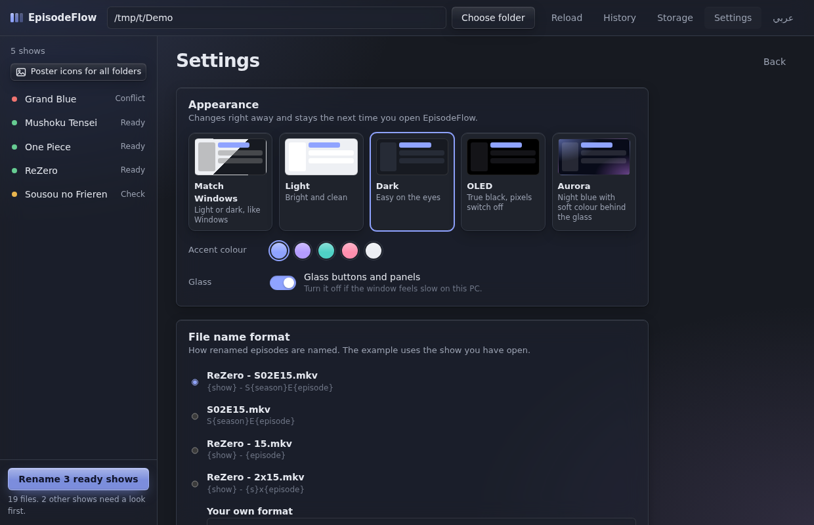
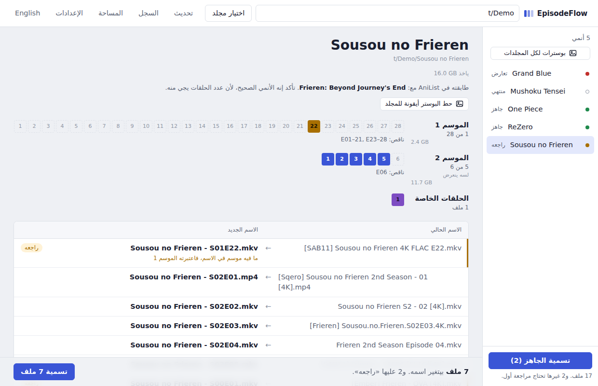
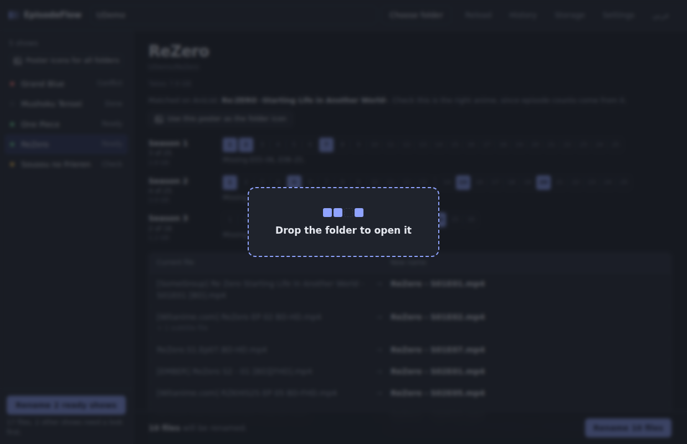

<b>English</b> | <a href="README.ar.md">العربية</a>

  

<h1 align="center">EpisodeFlow</h1>

  Turn messy anime downloads into clean, ordered episodes, so your player always knows what comes next. 
  <code>[SubsPlease] Sousou no Frieren - 05 (1080p) [A1B2C3D4].mkv</code> → <code>Sousou no Frieren - S02E05.mkv</code>

  <a href="../../releases/latest"><b>Download</b></a> ·
  <a href="#features">Features</a> ·
  <a href="#download-and-use">Download and use</a> ·
  <a href="#remove-it">Remove it</a>

---

## Features

### Reads the names nobody else can
Episodes from different groups in one folder? Abbreviations like `RZKHIS2SP2`, `Season 3 - 10`, `4x22`, `Ep.08`, hashes, `(1)` copies, `[4K]`, `FLAC`? EpisodeFlow works out the right season and episode for each file and keeps the **real episode numbers** (episodes 3 to 12 stay 3 to 12). Anything it isn't sure about is marked **Check** so you can look before renaming. Nothing changes until you press **Rename**.

### Knows every season and part, thanks to AniList
Part 2 / Cour 2 that restarts at episode 1? EpisodeFlow asks [AniList](https://anilist.co) how many episodes came before and continues the count (Re:Zero Season 2 Part 2, episode 2 becomes `S02E15`). It works even if you don't have a single episode of the first part.

### See what's missing at a glance
Every season gets an episode strip (see the screenshot at the top): filled squares are episodes you have, dashed ones are missing, and a line marks where Part 2 starts.

Long-running shows like One Piece or Detective Conan only show the episodes you have, grouped, with the gap in between:

### The anime poster as the folder icon
One click (or one click for all folders) and Windows shows each anime folder with its poster.

### Two copies of the same episode
EpisodeFlow shows both with their quality and size and suggests the better one. Keep both (the quality is added to the name), or keep one and move the other to the Recycle Bin. It always asks first.

### Themes and glass
Five themes in **Settings → Appearance**: Match Windows, Light, Dark, **OLED** (true black, so OLED pixels switch off) and **Aurora** (night blue with soft colour behind the glass). Buttons and panels are frosted glass, and there are five accent colours to pick from. Glass can be turned off if the window feels slow on an older PC.

| OLED | Aurora |
|---|---|
|  |  |

### Everything else
- **Many shows at once:** open a folder that has anime folders inside, and rename all the ready ones in one go.
- **Specials:** OVA, OAD, SP and `12.5` episodes go to Season 0.
- **Subtitles follow:** `.srt`, `.ass` and `.ar.srt` files are renamed with their episode.
- **History and undo:** every rename is kept, and any of them can be undone later.
- **Your own name format:** `Show - S01E05`, `S01E05`, `Show - 05`, `Show - 1x05`, or write your own.
- **Storage:** how much space each show and season takes, and your biggest files.
- **Drag and drop** a folder onto the window, or right-click a folder and use **Send to → EpisodeFlow**.
- **English and Arabic.** Your language and theme are remembered between runs.

| History | Storage |
|---|---|
|  |  |

| Settings | Arabic interface |
|---|---|
|  |  |

---

## Download and use

Windows 10 or 11.

1. Download **`EpisodeFlow.exe`** from the [latest release](../../releases/latest).
2. Put it anywhere you like (even in Downloads) and open it. Nothing to install, and it doesn't create any files next to itself.
3. The first time, it asks whether to add EpisodeFlow to your **Desktop** and the **Send To** menu. Say yes and you can open any anime folder with a right-click.

> **"Windows protected your PC"?** EpisodeFlow is free and not code-signed, so Windows warns about it the first time. Click **More info**, then **Run anyway**.

**Renaming:**
1. Drag an anime folder onto the window, click **Choose folder**, or right-click a folder → **Send to → EpisodeFlow**.
2. Check the new names. Click any file to change its season or episode.
3. Press **Rename**. Changed your mind? Press **Undo**.

Tip: name each folder after the anime (`Sousou no Frieren`, not `SNF`), so AniList finds the right show. One folder can hold several seasons.

---

## Remove it

Open EpisodeFlow → **Settings** → **Remove from this PC**. It removes its shortcuts, your history and settings, and `EpisodeFlow.exe` itself.

**Your anime files are never touched**: renamed files keep their new names.

Removing it by hand

1. Delete `EpisodeFlow.exe`.
2. Delete the EpisodeFlow shortcut from the Desktop, and from Send To (`Win + R` → `shell:sendto`).
3. Delete your data: `Win + R` → `%LOCALAPPDATA%\EpisodeFlow`.

---

## Privacy and data

EpisodeFlow runs on your PC. It only goes online to ask AniList about shows (and to download posters when you ask for folder icons). Your history, settings and the saved AniList info are kept in `%LOCALAPPDATA%\EpisodeFlow`. **Settings → Open data folder** takes you there.

## Credits

Anime data and posters come from [AniList](https://anilist.co). EpisodeFlow is not affiliated with AniList. It uses AniList's public API politely: requests are spaced out and results are kept for a few days, so opening the same folders again doesn't ask AniList again.

## Build from source

Needs Python 3 on Windows. Run `build.bat`: it installs the build tools (PyInstaller and pywebview) and creates `release\EpisodeFlow.exe`.

You can also run it straight from the source with `python src\episodeflow_gui.py`, and check the episode detection with `python tests\test_detection.py`.

## License

[MIT](LICENSE)
